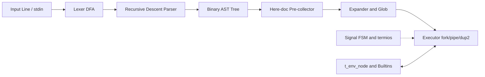

# Minishell — As Beautiful as a Shell

[](https://github.com/42GS/minishell/actions/workflows/ci.yml)
[](https://github.com/42GS/minishell/releases/latest)
[](https://github.com/42GS/minishell)
[](https://github.com/42GS/minishell/actions/workflows/ci.yml)
[](https://github.com/42GS/minishell/actions/workflows/ci.yml)

> **42 School Common Core System Programming Project**  
> **GitHub Wiki (요약 아키텍처 & 검증 가이드)**: [42GS/minishell Wiki](https://github.com/42GS/minishell/wiki)  
> **Knowledge Base (설계 명세 · CS 심화 · 회고록)**: [42GS/minishell-wiki](https://github.com/42GS/minishell-wiki)  
> **Reference Standard**: GNU Bash (`bash --posix` / POSIX.1-2017)

---

## 1. 프로젝트 개요 및 핵심 지표

`minishell`은 POSIX 호환 유닉스 셸을 C 언어로 바닥부터 구현한 시스템 프로그래밍 프로젝트입니다. Mandatory(파이프라인, 리다이렉션, Here-doc, 환경변수 확장, 7대 빌트인, 시그널/터미널 제어)와 Bonus(`&&`, `||`, `( )` 서브셸 우선순위, CWD `*` 와일드카드 Globbing) 사양을 모두 포함하며, 설계 단계부터 `42GS/minishell-wiki`에 아키텍처 명세와 평가 기준을 선행 정의한 뒤 구현·검증했습니다.

| 검증 항목 | 측정 결과 | 비고 |
| :--- | :--- | :--- |
| **프로덕션 코드 규모** | `51 .c` / `7 .h` (`4,476` LOC), 코어(`libft` 제외) **`3,896` LOC** | `189`개 함수, 42 Norminette `0` errors (`<= 25`줄/함수, `<= 5`함수/파일) |
| **코드 문서화 (`Doxygen`)** | **58개 전 파일** 영문 `/** ... */` 주석 적용 | 실행 코드·42 헤더 변경 0건, GlobalScope·78자 Norminette 통과 |
| **전역 변수 격리 (`nm -g`)** | 단일 전역 변수 **1개** (`volatile sig_atomic_t g_signal_num`) | 셸 컨텍스트(`t_shell`)는 포인터 인자로만 전달 |
| **외부 심볼 준수 (`nm -u`)** | 허용 심볼 **33종** (금지 심볼 **0건**) | 42 허용 외부 함수 53종(`realloc` 등 금지 제외) 엄격 준수 |
| **42evalhub 5대 E2E 벤치마크** | **37 / 37 (100.0%)**, 크래시·타임아웃 0건 | `LC_ALL=C` 환경 GNU Bash 1:1 차등 비교 (`tests/e2e/suites/01~05`) |
| **메모리 및 FD 누수 (Valgrind)** | `definitely lost: 0` / 열린 잔여 FD **0건** | 7종 C 단위 테스트 + 13종 Mandatory·Bonus·Error QA 통과 |
| **CI 파이프라인 실행 속도** | **`29 ~ 36s`** (`main` / PR) | `77 ~ 80s` 대비 최대 **-62.3%** (`ghcr.io/42gs/minishell-ci` + 병렬화) |

---

## 2. 시스템 아키텍처

원시 입력 문자열이 들어오면 DFA 어휘 분석기, 재귀 하향 AST 파서, 따옴표·분할·와일드카드 확장기, IPC 실행 엔진을 순차적으로 통과하며, 비동기 시그널 상태 머신(`g_signal_num`)과 환경변수 딕셔너리(`t_env_node`)가 전 계층을 보조합니다.



### 모듈 구성 (`src/` & `libft/`)

| 모듈 | 주요 파일 | 핵심 책임 |
| :--- | :--- | :--- |
| **Lexer** | `src/lexer/lexer.c`, `lexer_word.c`, `lexer_op.c`, `lexer_token.c` | `STATE_GENERAL` / `STATE_SQUOTE` / `STATE_DQUOTE` 상태 전이, `TOK_PIPE`/`TOK_AND_IF`/`TOK_OR_IF`/`TOK_AMP` 등 12종 토큰 분리 |
| **Parser** | `src/parser/parser.c`, `parser_cmd.c`, `parser_utils.c` | `&&`/`||` -> `\|` -> `(...)` 우선순위에 따른 AST(`NODE_AND`, `NODE_OR`, `NODE_PIPE`, `NODE_SUBSHELL`, `NODE_CMD`) 생성 및 구문 오류(`2`) 릭 프리 해제 |
| **Expander** | `src/expander/expander.c`, `expander_cmd.c`, `expander_split.c`, `expander_glob.c` | `$VAR`/`$?`/`$0..$9` 확장, 비인용 IFS 단어 분할, `ambiguous redirect` 검출, 인용 마스크 기반 `*` Globbing, Quote Removal |
| **Executor** | `src/executor/executor.c`, `executor_pipe.c`, `executor_redir.c`, `executor_heredoc.c`, `executor_path.c`, `executor_wait.c` | `(N-1)` 파이프 병렬 실행 및 Strict Pipe-Close, `O_EXCL` 익명 Here-doc, POSIX 빈 `PATH` 세그먼트 탐색, `126`/`127`/`128+N` 상태 정규화 |
| **Builtins & Env** | `src/builtins/builtin_*.c`, `src/env/env_*.c` | `t_env_node` 연결 리스트(`NULL` vs `""` 구분, `SHLVL`/`OLDPWD`), 7대 빌트인(`echo`, `cd`, `pwd`, `export`, `unset`, `env`, `exit`) |
| **Signals** | `src/signals/signals.c`, `signals_term.c` | `sigaction` 4-상태 전환(`SIG_STATE_INTERACTIVE`/`EXECUTION`/`CHILD`/`HEREDOC`), `ECHOCTL` 제어, `g_signal_num` 소비 |
| **Libft & `t_strbuf`** | `libft/src/*.c`, `libft/src/ft_strbuf.c` | 42 표준 유틸리티 및 `realloc` 없이 2배 용량 확장(`cap * 2`)을 구현한 $O(N)$ 가변 버퍼 |

---

## 3. 핵심 엔지니어링 결정과 트레이드오프

1. **Async-Signal-Safe 시그널 격리 및 `&&`/`||` 중단 처리**
   - 핸들러는 `volatile sig_atomic_t g_signal_num = signo;` 기록과 최소한의 `write`/`rl_*` 호출만 수행하며, `free()`·상태 갱신·`termios`(`ECHOCTL`) 복원은 메인 루프의 `sync_signal_status(ctx)`에서 안전하게 처리합니다.
   - `t_shell.interrupted` 플래그를 도입해 `cat || echo ...` 실행 중 자식 프로세스가 `SIGINT`로 종료되면 `(exit 130) || true` 같은 정상 `exit` 종료와 구분하여 후속 조건 리스트를 Bash와 동일하게 즉시 중단합니다.
2. **Here-doc 익명 임시 파일(`O_CREAT | O_EXCL`) 및 형제 FD 차단**
   - 파이프 기반 Here-doc은 커널 파이프 버퍼(64KB) 초과 시 `waitpid()`와 데드락을 일으킵니다. 대신 `/tmp/.minishell_hd_*` 경로를 `O_CREAT | O_EXCL` (`0600`)로 생성해 즉시 `unlink()`함으로써 파일 잔여물과 64KB 버퍼 제약을 동시에 없앴습니다.
   - 파이프 라인이나 서브셸 내부 자식이 포크된 직후에는 `close_ast_heredocs(node, skip)`로 자신의 AST 서브트리에 속하지 않는 타 브랜치 Here-doc FD를 즉시 닫아 Valgrind `--track-fds=yes` 기준 FD 누수를 차단했습니다.
3. **`realloc` 금지 제약 속 $O(N)$ 가변 버퍼 (`t_strbuf`)**
   - 과제 허용 함수에 `realloc`이 없어 반복 `ft_strjoin`을 사용하면 입력 길이에 비례해 $O(N^2)$ 복사가 발생합니다. `libft/src/ft_strbuf.c`에 capacity-doubling 전략을 직접 구현해 비대화형 stdin 읽기와 확장기 누적 비용을 $O(N)$으로 유지했습니다.
4. **병렬 인용 마스크(`t_exp_buf.mask`) 기반 CWD `*` 와일드카드 Globbing**
   - 확장 단계에서 문자 버퍼와 동일한 길이의 인용 마스크를 유지해 `'*.c'`·`"*"`·`"$PAT"`처럼 따옴표로 보호된 `*`는 리터럴로 남기고, 비인용 `*`만 확장합니다.
   - `opendir`/`readdir`/`closedir`로 현재 작업 디렉터리 엔트리를 수집한 뒤 `.`·`..` 및 선행 `.` 규칙(`globskipdots`), ASCII 정렬, 매칭 실패 시 원본 패턴 폴백을 적용해 Word Splitting -> Globbing -> Quote Removal 순서를 일관되게 지킵니다.
5. **Strict Pipe-Close 프로토콜 & 단일 빌트인 FD 최적화**
   - 파이프 자식은 자신의 표준 입출력 `dup2()` 완료 직후 부모로부터 상속받은 모든 파이프 FD를 닫고, 부모 역시 포크 완료 즉시 모든 파이프 양끝을 닫아 `EOF` 미수신 행(Hang)을 방지합니다.
   - 파이프라인 밖 단일 빌트인은 부모 상태를 직접 변경해야 하므로 리다이렉션이 있을 때만 `dup(STDIN_FILENO)`/`dup(STDOUT_FILENO)`로 백업·복원하고, 리다이렉션이 없는 경우에는 `execute_single_builtin()`에서 `dup` 비용 없이 즉시 디스패치합니다.
6. **실측 기반 GHCR 커스텀 CI 이미지 및 테스트 병렬화 (`77~80s -> 29~36s`)**
   - GitHub Actions API 스텝별 소요 시간을 계측해 실제 병목(`needs: norminette` 직렬 대기 `+20s`, 매 실행 `apt-get` `22~25s`, 유닛 테스트 38개 코어 소스 4회 중복 컴파일 `10~11s`, Valgrind 26회 직렬 실행 `15s`)을 특정했습니다.
   - `debian:bookworm-slim` + `libc6-dbg` 기반 경량 이미지(`ghcr.io/42gs/minishell-ci:latest`, 빌드 시 `valgrind --error-exitcode=42 /bin/true` 자가 검증)와 `needs` 제거 병렬 실행, `run_unit.sh` `obj/**/*.o` 정적 아카이브 재사용 링크(`11s -> 4s`), `run_valgrind_qa.sh` 멀티코어 병렬 워커(`15s -> 4~7s`)를 적용해 전체 CI 시간을 최대 **62.3%** 단축했습니다.
   - 병렬화 과정에서 확인한 GNU Make `re: fclean all`의 `-j` 레이스 조건(병렬 `make -j all`과 순차 `make re` 분리) 및 Valgrind 3.19(Debian `--log-file` FD 3) vs 3.26(Ubuntu `dup2`) 동작 차이를 모두 반영해 양쪽 환경 호환성을 확보했습니다.

---

## 4. 구버전(`minishell-old`) 대비 정량·정성 개선 요약

과제 100% 완료 후 아카이브 저장소([`42GS/minishell-old`](https://github.com/42GS/minishell-old))와 동일 머신(`LC_ALL=C`, `nm -g`/`nm -u`, 42evalhub 5대 스위트)에서 직접 대조한 결과입니다. (상세 분석: [Legacy Comparison Retrospective](https://github.com/42GS/minishell-wiki/blob/main/wiki/eval/legacy_retrospective.md))

| 지표 | `minishell-old` | `minishell` (현재) | 개선 결과 |
| :--- | :--- | :--- | :--- |
| **전체 / 코어 코드 (`libft` 제외)** | `9,283` / `7,883` LOC | `4,476` / `3,896` LOC | **-51.8% / -50.6% LOC 축소** |
| **전역 상태 관리 (`nm -g`)** | 숨겨진 `static` 싱글턴 2개 | 단일 `g_signal_num` 1개 | 서브젝트 전역변수 제약 100% 준수 |
| **외부 심볼 준수 (`nm -u`)** | 금지 심볼 링크 (`_getpid`, `_strcmp`) | 허용 심볼 33종 (금지 **0건**) | 평가 실격 요인 완전 제거 |
| **시그널 / Here-doc 안전성** | 핸들러 내 `free`/`exit`, 파이프 64KB 교착 위험 | Async-Signal-Safe + `O_EXCL` 즉시 `unlink` | 크래시·데드락·`Ctrl+D` NULL 역참조 제거 |
| **42evalhub 5대 E2E 벤치마크** | **20 / 37 (54.1%)**, 3건 타임아웃 | **37 / 37 (100.0%)**, 0 크래시/타임아웃 | **+45.9%p 통과율 향상** |
| **자동화 테스트 & CI 파이프라인** | 테스트 **0개** / CI 없음 | 테스트 파일 **18개** / 5계층 CI | PR마다 Norm·Build·E2E·PTY·Valgrind 검증 |

---

## 5. 디렉터리 구조

| 경로 | 설명 |
| :--- | :--- |
| `include/` | 6대 모듈 인터페이스 헤더 (`minishell.h`, `lexer.h`, `parser.h`, `executor.h`, `builtins.h`, `signals.h`) |
| `src/` | 모듈별 C 프로덕션 소스 (`lexer/`, `parser/`, `expander/`, `executor/`, `env/`, `builtins/`, `signals/`) |
| `libft/` | 42 표준 유틸리티 및 capacity-doubling `t_strbuf` 정적 라이브러리 |
| `tests/` | C 단위 테스트(`unit/test_*.c`), Bash 차등 E2E(`e2e/run_e2e.py`, `suites/01~05.json`), PTY 시그널(`test_signals_pty.py`), Valgrind QA(`run_valgrind_qa.sh`) |
| `.github/` | GitHub Issue/PR 템플릿 및 CI 워크플로우(`.github/workflows/ci.yml`: Norminette + Strict Build/No-Relink + 5계층 테스트) |

---

## 6. 빌드, 실행 및 5계층 자동화 검증

### 빌드 및 대화형 실행

```bash
# Mandatory & Bonus 빌드 (-Wall -Wextra -Werror, No-Relink)
make all && make bonus

# 대화형 셸 실행
./minishell

# 비대화형 파이프 입력 예시
echo "export GREETING=hello && (echo \$GREETING | cat -e)" | ./minishell
```

### 5계층 자동화 검증 (`tests/`)

```bash
# 1. C 단위 테스트 7종 (Linux 환경에서는 Valgrind 자동 연동)
bash tests/unit/run_unit.sh

# 2. Bash 1:1 차등 E2E 스모크 테스트 (47종 핵심 시나리오)
python3 tests/e2e/run_e2e.py --ci

# 3. 42evalhub 5대 평가 스위트 전체 (01~05, 37종)
python3 tests/e2e/run_e2e.py --all

# 4. 실제 PTY 기반 인터랙티브 시그널 테스트 8종 (Ctrl+C, Ctrl+\, Ctrl+D, ECHOCTL)
python3 tests/e2e/test_signals_pty.py

# 5. Valgrind 힙 메모리 릭 & 잔여 FD 0건 QA 13종 (Linux/CI 환경)
bash tests/e2e/run_valgrind_qa.sh

# (선택) macOS/로컬 환경에서 CI와 동일한 Linux 컨테이너로 원클릭 재현
docker run --rm -v "$PWD:/work" -w /work ghcr.io/42gs/minishell-ci:latest \
    bash -c "make -j && bash tests/unit/run_unit.sh && bash tests/e2e/run_valgrind_qa.sh"

# 빌드 산출물 정리
make fclean
```

---

## 7. 상세 문서 (Wiki & Knowledge Base)

- **GitHub Wiki**: [Home](https://github.com/42GS/minishell/wiki) · [Architecture Overview](https://github.com/42GS/minishell/wiki/Architecture-Overview) · [Parser & AST](https://github.com/42GS/minishell/wiki/Parser-and-AST) · [Execution Engine & IPC](https://github.com/42GS/minishell/wiki/Execution-Engine-and-IPC) · [Signal Handling & Builtins](https://github.com/42GS/minishell/wiki/Signal-Handling-and-Builtins) · [Testing & CI Verification](https://github.com/42GS/minishell/wiki/Testing-and-CI-Verification) · [Legacy Retrospective](https://github.com/42GS/minishell/wiki/Legacy-Retrospective)
- **Architecture Knowledge Base (`42GS/minishell-wiki`)**: [전체 위키 카탈로그 (`index.md`)](https://github.com/42GS/minishell-wiki/blob/main/index.md) · [Phase 1~4 아키텍처 명세](https://github.com/42GS/minishell-wiki/tree/main/wiki/architecture) · [CS 이론 심화 문서](https://github.com/42GS/minishell-wiki/tree/main/wiki/concepts) · [구버전 비교 회고록](https://github.com/42GS/minishell-wiki/blob/main/wiki/eval/legacy_retrospective.md)
