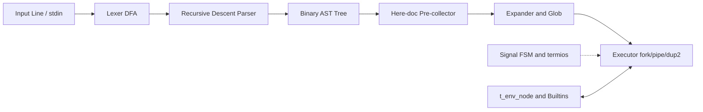

# Minishell — POSIX-Compatible Unix Shell in C

[](https://github.com/42GS/minishell/actions/workflows/ci.yml)
[](https://github.com/42GS/minishell/releases/latest)
[](https://github.com/42GS/minishell)
[](https://github.com/42GS/minishell/actions/workflows/ci.yml)
[](https://github.com/42GS/minishell/actions/workflows/ci.yml)

C99와 POSIX 시스템 콜 기반 유닉스 셸.  
사전 아키텍처 명세([`42GS/minishell-wiki`](https://github.com/42GS/minishell-wiki)), 5계층 자동화 QA, 경량 GHCR 컨테이너 CI 통합 구성.

- **유형**: 개인 프로젝트
- **기술 스택**: `C99` · `POSIX.1-2017` · `Linux` · `GNU Readline` · `Valgrind` · `Docker (GHCR)` · `GitHub Actions` · `Python`
- **GitHub Wiki (요약)**: [42GS/minishell Wiki](https://github.com/42GS/minishell/wiki)
- **Knowledge Base (설계·심화·회고)**: [42GS/minishell-wiki](https://github.com/42GS/minishell-wiki)

### 핵심 성과 한눈에 보기

| 코어 코드량 절감 | Bash 1:1 차등 E2E | 메모리 · FD 누수 | CI 파이프라인 속도 |
| :---: | :---: | :---: | :---: |
| **`-50.6%`** (`3,896` LOC) | **`100%`** (`37 / 37`) | **`0건`** (Heap & FD) | **`-62.3%`** (`29 ~ 36s`) |
| 구버전 `7,883` LOC 대비 | `LC_ALL=C` · 0 타임아웃 | Valgrind 단위 7 + QA 13종 | `77~80s -> 29~36s` (GHCR) |

- **전 파일 문서화**: 58개 소스·헤더에 Norminette 준수 영문 Doxygen 주석 적용 (실행 코드 변경 `0`건)

### 실행 & 검증 데모

```bash
$ make -j && ./minishell
minishell$ export TAG=ok && (echo "build:$TAG" | tr a-z A-Z) > /tmp/out && cat < /tmp/out
BUILD:OK
minishell$ echo Make*
Makefile
minishell$ cat << EOF | wc -l
line 1
line 2
EOF
2

# 자동화 검증 결과 (GitHub Actions / Linux Valgrind CI 기준)
[UNIT]     All 7 C unit suites PASSED (Valgrind 0 leaks)
[E2E-CI]   All 47 Bash-differential smoke checks PASSED
[E2E-ALL]  Summary: 37/37 passed, 0 failed (01~05 suites)
[PTY]      All 8 interactive signal & ECHOCTL tests PASSED
[VALGRIND] All 13 scenarios PASSED with 0 memory leaks and 0 FD leaks!
```

---

## 1. 시스템 아키텍처

원시 입력을 **어휘 분석 -> AST 파싱 -> Here-doc 수집 -> 확장/Globbing -> IPC 실행** 단계로 분리, 전체 상태를 `t_shell` 컨텍스트에 격리.



| 모듈 | 주요 소스 | 핵심 책임 |
| :--- | :--- | :--- |
| **Lexer** | `src/lexer/lexer*.c` | 3-상태 따옴표 DFA, 12종 토큰 분리 (`TOK_AMP` 등) |
| **Parser** | `src/parser/parser*.c` | 우선순위 AST 조립 (`(...)` > 리다이렉션 > `\|` > `&&`/`\|\|`), 오류 시 릭 프리 해제 |
| **Expander** | `src/expander/expander*.c` | `$VAR`/`$?` 확장, IFS 분할, `ambiguous redirect`, 인용 마스크 `*` Globbing |
| **Executor** | `src/executor/executor*.c` | `(N-1)` 파이프 병렬 실행, Strict Pipe-Close, `O_EXCL` Here-doc, 빈 `PATH` 탐색 |
| **Builtins & Env** | `src/builtins/*.c`, `src/env/*.c` | `t_env_node` (`NULL` vs `""`), 7대 빌트인 (`echo`, `cd`, `pwd`, `export`, `unset`, `env`, `exit`) |
| **Signals** | `src/signals/signals*.c` | 단일 `g_signal_num` 4-상태 `sigaction`, `termios` `ECHOCTL` 제어 |
| **Libft & `t_strbuf`** | `libft/src/*.c` | `realloc` 없는 2배 확장 `O(N)` 가변 버퍼 `t_strbuf` |

---

## 2. 핵심 문제 해결 및 트레이드오프

| 과제 | 해결 방식 | 검증 결과 |
| :--- | :--- | :--- |
| **비동기 시그널 & 리스트 중단** | 핸들러 내 `g_signal_num` 단일 기록, `ctx->interrupted`로 `(exit 130)` 구분 | PTY 8종 통과, Self-Deadlock 제로 |
| **Here-doc 64KB 데드락 & FD 누수** | `O_CREAT \| O_EXCL` + 즉시 `unlink()`, `close_ast_heredocs()` FD 격리 | `--track-fds=yes` 잔여 FD 0건 |
| **`realloc` 없는 문자열 `O(N^2)` 병목** | `t_strbuf` capacity-doubling(`cap * 2`) 동적 버퍼 구현 | 확장기·stdin 누적 비용 `O(N)` 유지 |
| **따옴표별 `*` 억제 & CWD 확장** | 병렬 `t_exp_buf.mask` + `opendir`/`readdir` (`globskipdots`, ASCII 정렬) | `05_bonus.json` 9/9 및 스모크 7종 통과 |
| **파이프 EOF 행 & 빌트인 FD 훼손** | 부모·자식 미사용 파이프 즉시 닫기, 무리다이렉션 빌트인 `dup` 생략 | 다중 파이프·리다이렉션 FD 누수 0건 |
| **CI 80초 지연 병목** | API 계측 기반 GHCR 이미지 + `needs` 제거 + `obj/*.o` 아카이브 + 병렬 QA | CI 총 시간 **`77~80s -> 29~36s` (-62.3%)** |

<details>
<summary><b>상세 설계 근거 및 트러블슈팅 펼치기 (6건)</b></summary>

1. **Async-Signal-Safe 격리 & `ctx->interrupted`**
   - **원칙**: 핸들러 내부 `free()` 금지, `g_signal_num`만 원자적 기록
   - **해결**: 메인 루프 `sync_signal_status(ctx)`에서 `130`/`131` 및 `ECHOCTL` 복원
   - **분리**: `ctx->interrupted`로 `SIGINT` 중단과 `(exit 130) || true` 정상 종료 구분

2. **익명 Here-doc (`O_CREAT | O_EXCL`) & 형제 FD 정리**
   - **문제**: 파이프 기반 Here-doc 64KB 커널 버퍼 초과 시 `waitpid()` 교착 발생
   - **해결**: `/tmp/.minishell_hd_*`를 `O_EXCL`(`0600`)로 생성 후 즉시 `unlink()` 처리
   - **격리**: 파이프·서브셸 자식은 `close_ast_heredocs(node, skip)`로 타 브랜치 FD 정리

3. **`realloc` 없는 `t_strbuf` (`O(N)`)**
   - **제약**: 허용 함수 53종 중 `realloc` 부재로 반복 `ft_strjoin` 시 `O(N^2)` 복사 발생
   - **해결**: 2배 용량 확장 버퍼 구현, 확장기와 비대화형 stdin 리더에 적용

4. **인용 마스크(`t_exp_buf.mask`) 기반 Globbing**
   - **동작**: `'*.c'`·`"*"`·`"$PAT"`의 보호 별표를 `'0'`으로 마킹해 리터럴 보존
   - **규칙**: 비인용 `'*'`(`'1'`)만 `globskipdots`·ASCII 정렬·원문 폴백 규칙으로 확장

5. **Strict Pipe-Close & 단일 빌트인 FD 최적화**
   - **파이프**: 자식은 `dup2()` 직후, 부모는 포크 직후 모든 파이프 양끝 즉시 `close`
   - **빌트인**: `!cmd->redirs` 조건 시 `dup(0)`/`dup(1)` 백업 없이 즉시 디스패치

6. **CI 병목 계측 및 Make · Valgrind 호환성 해결**
   - **계측**: GitHub Actions API 기반 병목 분리 (`apt-get` 25s, 직렬 대기 20s, 중복 컴파일 11s, Valgrind 15s)
   - **개선**: `debian:bookworm-slim` GHCR 이미지, `obj/*.o` 정적 아카이브 링크(`4s`), 13종 병렬 Valgrind(`4~7s`) 적용
   - **트러블슈팅 (Make)**: `re: fclean all`의 `-j` 레이스 회피를 위한 병렬 `make -j all` · 순차 `make re` 분리
   - **트러블슈팅 (Valgrind)**: 3.26(`dup2` 표준 FD)과 3.19(`libc6-dbg` 필수, `--log-file` FD 3) 차이 대응 ([run_valgrind_qa.sh](tests/e2e/run_valgrind_qa.sh))

</details>

---

## 3. 구버전(`minishell-old`) 대비 재설계 성과

아카이브([`42GS/minishell-old`](https://github.com/42GS/minishell-old))와 동일 머신(`LC_ALL=C`, `nm -g`/`nm -u`, 42evalhub 5대 스위트) 대조 결과 ([상세 회고록](https://github.com/42GS/minishell-wiki/blob/main/wiki/eval/legacy_retrospective.md))

| 지표 | `minishell-old` (구버전) | `minishell` (재설계) | 개선 결과 |
| :--- | :--- | :--- | :--- |
| **코드 규모 (`libft` 제외)** | `9,283` / `7,883` LOC (`263` 함수) | `4,476` / `3,896` LOC (`189` 함수) | **-51.8% / -50.6% LOC**, Norm 0 errors |
| **전역 상태 (`nm -g`)** | 숨겨진 `static` 싱글턴 2개 | 단일 `g_signal_num` 1개 | 서브젝트 전역변수 제약 100% 준수 |
| **외부 심볼 (`nm -u`)** | 금지 심볼 링크 (`_getpid`, `_strcmp`) | 허용 심볼 33종 (금지 **0건**) | 평가 실격 요인 제거 |
| **시그널 / Here-doc 안전성** | 핸들러 내 `free`/`exit`, 64KB 교착 | Async-Signal-Safe + `O_EXCL` 즉시 `unlink` | 크래시·데드락·`Ctrl+D` NULL 역참조 제거 |
| **42evalhub 5대 E2E** | **20 / 37 (54.1%)**, 3건 타임아웃 | **37 / 37 (100.0%)**, 0 크래시/타임아웃 | **+45.9%p 향상** |
| **테스트 / CI / 문서화** | 테스트 0개 / CI·문서 없음 | 테스트 18개 / **`29~36s` CI** / 58파일 Doxygen | Valgrind 0 leaks · 1줄 Docker QA |

---

## 4. 빌드, 실행 및 5계층 자동화 검증

```bash
# 빌드 & 실행 (-Wall -Wextra -Werror, No-Relink)
make -j && ./minishell

# 5계층 자동화 검증
bash tests/unit/run_unit.sh            # 1. C 단위 테스트 7종 (Linux: Valgrind 연동)
python3 tests/e2e/run_e2e.py --ci      # 2. Bash 1:1 차등 스모크 47종
python3 tests/e2e/run_e2e.py --all     # 3. 42evalhub 5대 스위트 37종
python3 tests/e2e/test_signals_pty.py  # 4. PTY 시그널·ECHOCTL 테스트 8종
bash tests/e2e/run_valgrind_qa.sh      # 5. Valgrind 힙 & FD QA 13종 (Linux/CI)

# macOS/로컬에서 CI와 동일한 Linux Valgrind 환경 재현
docker run --rm -v "$PWD:/work" -w /work ghcr.io/42gs/minishell-ci:latest \
    bash -c "make -j && bash tests/unit/run_unit.sh && bash tests/e2e/run_valgrind_qa.sh"
```

<details>
<summary><b>디렉터리 구조 보기</b></summary>

| 경로 | 설명 |
| :--- | :--- |
| `include/` | 6대 모듈 인터페이스 헤더 (`minishell.h`, `lexer.h`, `parser.h`, `executor.h`, `builtins.h`, `signals.h`) |
| `src/` | 모듈별 C 프로덕션 소스 (`lexer/`, `parser/`, `expander/`, `executor/`, `env/`, `builtins/`, `signals/`) |
| `libft/` | 42 표준 유틸리티 및 `t_strbuf` 정적 라이브러리 |
| `tests/` | C 단위(`unit/`), Bash 차등 E2E(`e2e/`), PTY 시그널(`test_signals_pty.py`), Valgrind QA(`run_valgrind_qa.sh`) |
| `.github/` | GHCR CI 이미지(`docker/`), Issue/PR 템플릿, CI 워크플로우(`ci.yml`, `ci-image.yml`) |

</details>

---

## 5. 상세 문서 (Wiki & Knowledge Base)

### GitHub Wiki (`42GS/minishell`)
- [Home](https://github.com/42GS/minishell/wiki) — 핵심 지표 요약 및 목차
- [Architecture Overview](https://github.com/42GS/minishell/wiki/Architecture-Overview) — 데이터플로우, `t_shell` 소유권, 7대 모듈 역할
- [Parser & AST](https://github.com/42GS/minishell/wiki/Parser-and-AST) — DFA Lexer, EBNF 우선순위, 구문 오류 처리
- [Execution Engine & IPC](https://github.com/42GS/minishell/wiki/Execution-Engine-and-IPC) — Strict Pipe-Close, 익명 Here-doc, `t_strbuf` & `*` Globbing
- [Signal Handling & Builtins](https://github.com/42GS/minishell/wiki/Signal-Handling-and-Builtins) — 4-상태 시그널 머신, `ECHOCTL`, `t_env_node` & 7대 빌트인
- [Testing & CI Verification](https://github.com/42GS/minishell/wiki/Testing-and-CI-Verification) — GHCR CI 최적화 실측 비교 및 Valgrind/Make 트러블슈팅
- [Legacy Retrospective](https://github.com/42GS/minishell/wiki/Legacy-Retrospective) — `minishell-old` 대비 정량·정성 개선 분석

### Architecture Knowledge Base (`42GS/minishell-wiki`)
- [전체 카탈로그 (`index.md`)](https://github.com/42GS/minishell-wiki/blob/main/index.md) — 33개 문서 1:1 상호 참조 색인
- [Phase 1~4 아키텍처 명세 (`wiki/architecture/`)](https://github.com/42GS/minishell-wiki/tree/main/wiki/architecture) — 상세 설계서 및 C 구조체
- [CS 이론 심화 문서 (`wiki/concepts/`)](https://github.com/42GS/minishell-wiki/tree/main/wiki/concepts) — 오토마타·CoW·시그널·`environ`·허용 함수 53종
- [구버전 비교 회고록 (`legacy_retrospective.md`)](https://github.com/42GS/minishell-wiki/blob/main/wiki/eval/legacy_retrospective.md) — 동일 머신 벤치마크 원문 보고서
