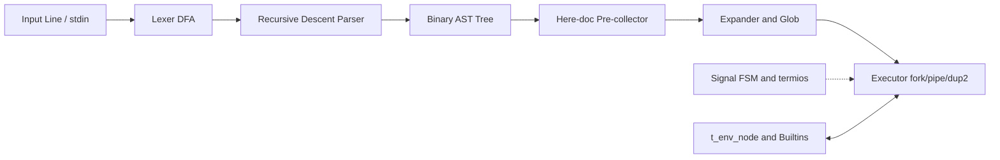

# Minishell — POSIX-Compatible Unix Shell in C

[](https://github.com/42GS/minishell/actions/workflows/ci.yml)
[](https://github.com/42GS/minishell/releases/latest)
[](https://github.com/42GS/minishell)
[](https://github.com/42GS/minishell/actions/workflows/ci.yml)
[](https://github.com/42GS/minishell/actions/workflows/ci.yml)

표준 셸의 도움 없이 C 언어와 POSIX 시스템 콜만으로 프로세스 생성·파이프라인 IPC·리다이렉션·시그널·와일드카드 확장을 구현한 유닉스 셸입니다. 구현에 앞서 [아키텍처 지식 베이스(`42GS/minishell-wiki`)](https://github.com/42GS/minishell-wiki)에 파서·실행 엔진·시그널 설계를 먼저 명세한 뒤, 5계층 자동화 QA와 경량 GHCR 컨테이너 CI까지 직접 구축했습니다.

- **구성**: 개인 프로젝트 (1인 설계·구현·QA·CI)
- **기술 스택**: `C99` · `POSIX.1-2017` · `Linux` · `GNU Readline` · `Valgrind` · `Docker (GHCR)` · `GitHub Actions` · `Python`
- **상세 문서**: [GitHub Wiki (요약 가이드)](https://github.com/42GS/minishell/wiki) · [Architecture Knowledge Base (설계·CS 심화·회고)](https://github.com/42GS/minishell-wiki)

### 핵심 성과 한눈에 보기

| 코어 코드량 절감 | Bash 1:1 차등 E2E | 메모리 · FD 누수 | CI 파이프라인 속도 |
| :---: | :---: | :---: | :---: |
| **`-50.6%`** (`3,896` LOC) | **`100%`** (`37 / 37`) | **`0건`** (Heap & FD) | **`-62.3%`** (`29 ~ 36s`) |
| 구버전 `7,883` LOC 대비 축소 · 58개 파일 Doxygen 완료 (`0` 로직 변경) | `LC_ALL=C` 환경 크래시·타임아웃 0건 | Valgrind 7종 단위 + 13종 QA 통과 | `77~80s` -> `29~36s` (GHCR 이미지 + 병렬화) |

### 실행 & 검증 데모

```bash
$ make -j && ./minishell
minishell$ export TAG=ok && (echo "build:$TAG" | tr a-z A-Z) > /tmp/out && cat < /tmp/out
BUILD:OK
minishell$ echo Make*
Makefile
minishell$ cat << EOF | wc -l
line 1
line 2
EOF
2

# 자동화 검증 결과 (GitHub Actions / Linux Valgrind CI 기준)
[UNIT]     All 7 C unit suites PASSED (Valgrind 0 leaks)
[E2E-CI]   All 47 Bash-differential smoke checks PASSED
[E2E-ALL]  Summary: 37/37 passed, 0 failed (01~05 suites)
[PTY]      All 8 interactive signal & ECHOCTL tests PASSED
[VALGRIND] All 13 scenarios PASSED with 0 memory leaks and 0 FD leaks!
```

---

## 1. 시스템 아키텍처

입력 라인을 곧바로 실행하지 않고 **DFA 어휘 분석 -> 재귀 하향 AST -> Here-doc 사전 수집 -> 인용·분할·Glob 확장 -> IPC 실행** 단계로 분리해, 상태 변이와 리소스 소유권을 `t_shell` 컨텍스트에 격리했습니다.



| 모듈 | 주요 소스 | 핵심 책임 |
| :--- | :--- | :--- |
| **Lexer** | `src/lexer/lexer*.c` | `STATE_GENERAL`/`SQUOTE`/`DQUOTE` 상태 머신, `TOK_PIPE`/`AND_IF`/`OR_IF`/`AMP` 등 12종 토큰 분리 |
| **Parser** | `src/parser/parser*.c` | `(...)` > 리다이렉션 > `\|` > `&&`/`\|\|` 우선순위 AST 조립, 구문 오류(`2`) 릭 프리 해제 |
| **Expander** | `src/expander/expander*.c` | `$VAR`/`$?`/`$0..$9` 확장, 비인용 IFS 단어 분할, `ambiguous redirect`, 인용 마스크 `*` Globbing |
| **Executor** | `src/executor/executor*.c` | `(N-1)` 파이프 병렬 실행 및 Strict Pipe-Close, `O_EXCL` Here-doc, 빈 `PATH` 세그먼트 및 `126`/`127` 처리 |
| **Builtins & Env** | `src/builtins/*.c`, `src/env/*.c` | `t_env_node`(`NULL` vs `""` 구분, `SHLVL`/`OLDPWD`), 7대 빌트인(`echo`, `cd`, `pwd`, `export`, `unset`, `env`, `exit`) |
| **Signals** | `src/signals/signals*.c` | 단일 `g_signal_num` 기반 `sigaction` 4-상태 머신, `termios` `ECHOCTL` 제어 |
| **Libft & `t_strbuf`** | `libft/src/*.c` | 42 표준 유틸리티 및 `realloc` 없이 2배 확장을 구현한 `O(N)` 가변 버퍼 `t_strbuf` |

---

## 2. 핵심 문제 해결 및 트레이드오프

| 과제 (Problem) | 해결 (Solution) | 검증 결과 (Result) |
| :--- | :--- | :--- |
| **비동기 시그널 재진입성 & 조건 리스트 중단** | 핸들러는 `volatile sig_atomic_t g_signal_num`만 기록하고 해제는 루프에 위임; `ctx->interrupted`로 `(exit 130)`과 구분 | PTY 8종 시그널 테스트 통과, Self-Deadlock 제로 |
| **Here-doc 64KB 파이프 데드락 & 형제 FD 누수** | `O_CREAT \| O_EXCL` + 즉시 `unlink()` 익명 파일 사용 및 `close_ast_heredocs()`로 타 브랜치 FD 차단 | `--track-fds=yes` 잔여 FD 0건, 임시 파일 잔존 0건 |
| **`realloc` 금지 환경에서 문자열 누적 `O(N^2)` 병목** | `libft/src/ft_strbuf.c`에 capacity-doubling(`cap * 2`) 동적 버퍼 직접 구현 | 비대화형 stdin 및 확장기 누적 비용 `O(N)` 유지 |
| **따옴표 종류별 `*` 와일드카드 억제와 CWD 확장** | 문자 버퍼와 동일 길이의 `t_exp_buf.mask` 병렬 유지 + `opendir`/`readdir` (`globskipdots`) | `05_bonus.json` 9/9 및 와일드카드 스모크 7종 100% 통과 |
| **파이프라인 EOF 행(Hang) & 빌트인 FD 훼손** | 부모·자식 양측 미사용 파이프 FD 즉시 닫기, 무리다이렉션 단일 빌트인 `dup` 조기 반환 | 다중 파이프 및 `export > file` FD 누수 0건 |
| **CI 80초 지연 병목 (직렬 Job·`apt-get`·중복 컴파일)** | API 계측 후 GHCR 경량 이미지 + `needs` 제거 + `obj/*.o` 아카이브 + 병렬 Valgrind 적용 | CI 총 시간 **`77~80s -> 29~36s` (-62.3%)** 단축 |

<details>
<summary><b>상세 설계 근거 및 트러블슈팅 펼치기 (6건)</b></summary>

1. **Async-Signal-Safe 격리 & `ctx->interrupted`**
   - 시그널 핸들러 안에서 `free()`나 상태 조작을 하지 않고 `g_signal_num`만 원자적으로 기록한 뒤, 메인 루프 `sync_signal_status(ctx)`에서 `130`/`131` 및 `termios`(`ECHOCTL`)를 복원합니다.
   - `cat || echo ...` 실행 중 `SIGINT`가 들어오면 `ctx->interrupted`를 세팅해 후속 `&&`/`||` 평가를 즉시 멈추되, `(exit 130) || true` 같은 정상 종료는 그대로 단락 평가합니다.
2. **익명 Here-doc (`O_CREAT | O_EXCL`) & 형제 FD 정리**
   - 파이프 기반 Here-doc은 64KB 커널 버퍼 초과 시 `waitpid()`와 교착 상태에 빠집니다. `/tmp/.minishell_hd_*`를 `O_EXCL`(`0600`)로 열고 즉시 `unlink()`해 파일 잔여물과 크기 제약을 동시에 해소했습니다.
   - 파이프라인·서브셸 자식은 `close_ast_heredocs(node, skip)`로 자신의 서브트리 외 Here-doc FD를 즉시 닫습니다.
3. **`realloc` 없는 `t_strbuf` (`O(N)`)**
   - 허용 함수 53종 중 `realloc`이 없어 `ft_strjoin` 반복 시 `O(N^2)` 복사가 발생하므로, 용량 2배 확장 버퍼를 직접 구현해 확장기와 stdin 리더에 적용했습니다.
4. **인용 마스크(`t_exp_buf.mask`) 기반 Globbing**
   - `'*.c'`·`"*"`·`"$PAT"`의 보호된 별표를 마스크 `'0'`으로 마킹해 리터럴로 보존하고, 비인용 `'*'`(`'1'`)만 CWD 엔트리(`globskipdots` 준수, ASCII 정렬, 미매칭 시 원문 폴백)와 매칭합니다.
5. **Strict Pipe-Close & 단일 빌트인 FD 최적화**
   - 파이프라인 밖 단일 빌트인이 `!cmd->redirs`일 때는 `dup(0)`/`dup(1)` 백업을 건너뛰고 즉시 실행해 시스템 콜과 Valgrind FD 이력 오버헤드를 제거했습니다.
6. **CI 병목 계측 및 GNU Make / Valgrind 환경 호환성 트러블슈팅**
   - GitHub Actions API 타임스탬프 계측으로 병목을 분리해, [Dockerfile](.github/docker/Dockerfile)(`debian:bookworm-slim` + `libc6-dbg`) 기반 `ghcr.io/42gs/minishell-ci:latest` 이미지 도입, `run_unit.sh` 정적 아카이브 재사용(`10~11s -> 4s`), `run_valgrind_qa.sh` 멀티코어 병렬화(`15s -> 4~7s`)를 적용했습니다.
   - 루트 `Makefile`의 `re: fclean all`이 `-j`에서 경합하는 레이스를 발견해 `make -j all`과 순차 `make re`를 분리했고, Valgrind 3.19(Debian `--log-file` FD 3)와 Valgrind 3.26(Ubuntu `dup2`) 양쪽에서 오탐 없이 누수 0건을 검증하도록 [run_valgrind_qa.sh](tests/e2e/run_valgrind_qa.sh)를 보강했습니다.

</details>

---

## 3. 구버전(`minishell-old`) 대비 재설계 성과

과제 100% 완료 후 아카이브([`42GS/minishell-old`](https://github.com/42GS/minishell-old))와 동일 머신(`LC_ALL=C`, `nm -g`/`nm -u`, 42evalhub 5대 스위트)에서 직접 대조한 결과입니다. ([상세 회고 보고서](https://github.com/42GS/minishell-wiki/blob/main/wiki/eval/legacy_retrospective.md))

| 지표 | `minishell-old` (구버전) | `minishell` (재설계) | 개선 결과 |
| :--- | :--- | :--- | :--- |
| **전체 / 코어 코드 (`libft` 제외)** | `9,283` / `7,883` LOC (`263` 함수) | `4,476` / `3,896` LOC (`189` 함수) | **-51.8% / -50.6% LOC 축소**, Norm 0 errors |
| **전역 상태 관리 (`nm -g`)** | 숨겨진 `static` 싱글턴 2개 | 단일 `g_signal_num` (`1`개) | 서브젝트 단일 전역변수 제약 100% 준수 |
| **외부 심볼 준수 (`nm -u`)** | 금지 심볼 링크 (`_getpid`, `_strcmp`) | 허용 심볼 `33`종 (금지 **0건**) | 평가 실격 요인 완전 제거 |
| **시그널 / Here-doc 안전성** | 핸들러 내 `free`/`exit`, 파이프 64KB 교착 | Async-Signal-Safe + `O_EXCL` 즉시 `unlink` | 크래시·데드락·`Ctrl+D` NULL 역참조 제거 |
| **42evalhub 5대 E2E (`01~05`)** | **20 / 37 (54.1%)**, 3건 타임아웃 | **37 / 37 (100.0%)**, 0 크래시/타임아웃 | **+45.9%p 통과율 향상** |
| **테스트 / CI / 문서화** | 테스트 `0`개 / CI·문서 없음 | 테스트 `18`개 / CI **`29~36s`** / **58파일 Doxygen** | Valgrind 0 leaks · 1줄 Docker QA 재현 |

---

## 4. 빌드, 실행 및 5계층 자동화 검증

```bash
# 빌드 & 실행 (-Wall -Wextra -Werror, No-Relink)
make -j && ./minishell

# 5계층 자동화 검증 (tests/)
bash tests/unit/run_unit.sh        # 1. C 단위 테스트 7종 (Linux 환경 Valgrind 자동 연동)
python3 tests/e2e/run_e2e.py --ci  # 2. Bash 1:1 차등 스모크 테스트 47종
python3 tests/e2e/run_e2e.py --all # 3. 42evalhub 5대 평가 스위트 37종
python3 tests/e2e/test_signals_pty.py # 4. 실제 PTY 시그널·ECHOCTL 테스트 8종
bash tests/e2e/run_valgrind_qa.sh  # 5. Valgrind 힙 & FD 누수 QA 13종 (Linux/CI)

# macOS/로컬에서 CI와 동일한 Linux Valgrind 환경 1줄 재현
docker run --rm -v "$PWD:/work" -w /work ghcr.io/42gs/minishell-ci:latest \
    bash -c "make -j && bash tests/unit/run_unit.sh && bash tests/e2e/run_valgrind_qa.sh"
```

<details>
<summary><b>디렉터리 구조 보기</b></summary>

| 경로 | 설명 |
| :--- | :--- |
| `include/` | 6대 모듈 인터페이스 헤더 (`minishell.h`, `lexer.h`, `parser.h`, `executor.h`, `builtins.h`, `signals.h`) |
| `src/` | 모듈별 C 프로덕션 소스 (`lexer/`, `parser/`, `expander/`, `executor/`, `env/`, `builtins/`, `signals/`) |
| `libft/` | 42 표준 유틸리티 및 capacity-doubling `t_strbuf` 정적 라이브러리 |
| `tests/` | C 단위 테스트(`unit/`), Bash 차등 E2E(`e2e/`), PTY 시그널(`test_signals_pty.py`), Valgrind QA(`run_valgrind_qa.sh`) |
| `.github/` | GHCR CI 이미지(`docker/`), Issue/PR 템플릿, CI 워크플로우(`ci.yml`, `ci-image.yml`) |

</details>

---

## 5. 상세 문서 (Wiki & Knowledge Base)

- **GitHub Wiki**: [Home](https://github.com/42GS/minishell/wiki) · [Architecture Overview](https://github.com/42GS/minishell/wiki/Architecture-Overview) · [Parser & AST](https://github.com/42GS/minishell/wiki/Parser-and-AST) · [Execution Engine & IPC](https://github.com/42GS/minishell/wiki/Execution-Engine-and-IPC) · [Signal Handling & Builtins](https://github.com/42GS/minishell/wiki/Signal-Handling-and-Builtins) · [Testing & CI Verification](https://github.com/42GS/minishell/wiki/Testing-and-CI-Verification) · [Legacy Retrospective](https://github.com/42GS/minishell/wiki/Legacy-Retrospective)
- **Architecture Knowledge Base (`42GS/minishell-wiki`)**: [전체 카탈로그 (`index.md`)](https://github.com/42GS/minishell-wiki/blob/main/index.md) · [Phase 1~4 아키텍처 명세](https://github.com/42GS/minishell-wiki/tree/main/wiki/architecture) · [CS 이론 심화 문서](https://github.com/42GS/minishell-wiki/tree/main/wiki/concepts) · [구버전 비교 회고록](https://github.com/42GS/minishell-wiki/blob/main/wiki/eval/legacy_retrospective.md)
